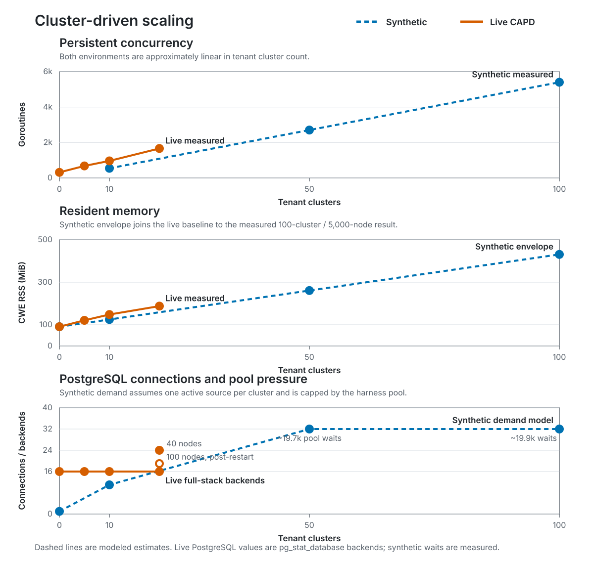
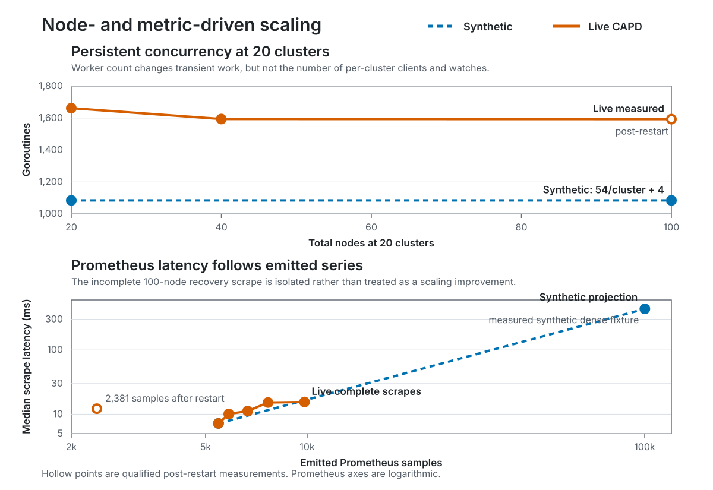

# nke-controller scalability and resource sizing

## Executive summary

At the largest synthetic topology—100 tenant clusters and 5,000 nodes—the
`nke-controller` process used approximately 431 MiB RSS and one CPU core during
active work. A separate live CAPD sweep created 20 clusters and 100 real Docker
nodes with SPIFFE-authenticated agents. Before a restart, CWE peaked at
approximately 210 MiB RSS; after recovery it settled at approximately 137 MiB.

Use the higher tier selected by either cluster or node count:

| Tenant scale | CPU request | CPU limit | Memory request | Memory limit |
|---|---:|---:|---:|---:|
| Up to 10 clusters or 500 nodes | 1 vCPU | 2 vCPU | 512 MiB | 1 GiB |
| Up to 50 clusters or 2,500 nodes | 2 vCPU | 4 vCPU | 1 GiB | 2 GiB |
| Up to 100 clusters or 5,000 nodes | 4 vCPU | 8 vCPU | 2 GiB | 4 GiB |
| Up to 200 clusters or 10,000 nodes | 8 vCPU | 16 vCPU | 4 GiB | 8 GiB |
| Beyond 200 clusters or 10,000 nodes | Load test required | Load test required | Load test required | Load test required |

The 100-cluster tier is the largest resource-measured configuration. The
200-cluster tier is an initial test configuration, not a validated capacity
claim. Where platform policy permits it, omit the CPU limit to avoid throttling
during correlated lifecycle work and scrapes; always retain a memory limit.

For the largest tested topology, start with:

```yaml
resources:
  requests:
    cpu: "4"
    memory: 2Gi
  limits:
    cpu: "8"
    memory: 4Gi
```

The likely limits are database reconciliation volume and connection-pool
contention, followed by per-cluster watches and allocation-heavy Prometheus
scrapes. The live test also showed that a burst can delay leader-election lease
renewal when CWE shares an overloaded management cluster with CAPD and all
tenant control planes. Adding controller CPU alone will not remove these
bottlenecks.

## Scope

This report sizes the `nke-controller` pod: its REST API, PostgreSQL
controllers, Temporal workers, tenant Kubernetes clients, `nke-agent` clients,
and Prometheus collector. PostgreSQL, Temporal, CAPI providers, management and
tenant control planes, and node agents require separate capacity planning.

The synthetic tests deliberately excluded the resource cost of tenant control
planes and thousands of agents so CWE could be measured in isolation. Those
costs do not belong in the CWE pod recommendation. They do matter when sizing a
CAPD load generator because every simulated node and control plane runs on the
same host and can contend with the management cluster.

## Findings

### Persistent cost follows cluster count

The synthetic tenant-manager test measured approximately two long-lived
Kubernetes watches and 54 goroutines per cluster:

| Clusters | Watches | Goroutines |
|---:|---:|---:|
| 10 | 20 | 544 |
| 50 | 100 | 2,704 |
| 100 | 200 | 5,404 |

The live sweep showed the same order of growth, with approximately 65–73
additional goroutines per cluster at 5 and 10 clusters and about 67 per cluster
at 20 clusters. Adding 60 workers while holding at 20 clusters did not increase
the steady goroutine count. Cluster count therefore drives persistent clients,
watches, and goroutines; node count primarily drives reconciliation, database,
agent RPC, and metric work.

### Scaling curves

The following figures compare measured live CAPD behavior with synthetic
measurements or explicitly modeled estimates. Dashed lines are projections,
not additional observations.



The PostgreSQL figure compares full-stack live backend counts with a synthetic
connection-demand model capped by the harness's 32-connection pool. The pool
wait counts at 50 and 100 clusters are measured synthetic results.



Prometheus latency is plotted against emitted samples rather than node count
because node pools and retained node sets also contribute series. The hollow
2,381-sample point is the incomplete post-restart scrape and is excluded from
the live scaling line.

### Live CAPD sweep

The live test ran commit `5b35b60158bdcd849961de9f6a85cb3d5f19506b`
on an AWS `m8g.16xlarge` with 64 vCPUs, 247 GiB RAM, and a 300-GiB gp3 volume.
It used a Kind management cluster, CAPI/CAPD v1.12.3, PostgreSQL, Temporal,
SPIRE, kubeadm, Calico, and the production node-agent binary. Agents connected
to CWE using SPIFFE join-token mTLS; agent RPCs and node commands were real.

| Ready topology | List API | Median scrape | Response | CWE RSS | Goroutines |
|---|---:|---:|---:|---:|---:|
| 0 clusters / 0 nodes | 3.2 ms | 7.2 ms | 1.32 MiB | 90.7 MiB | 314 |
| 5 clusters / 5 nodes | 3.8 ms | 10.1 ms | 1.40 MiB | 120.7 MiB | 679 |
| 10 clusters / 10 nodes | 4.4 ms | 11.2 ms | 1.52 MiB | 148.2 MiB | 962 |
| 20 clusters / 20 nodes | 4.9 ms | 15.2 ms | 1.68 MiB | 187.7 MiB | 1,662 |
| 20 clusters / 40 nodes | 4.8 ms | 15.5 ms | 1.97 MiB | 210.2 MiB | 1,594 |
| 20 clusters / 100 nodes, after restart | 5.3 ms | 12.2 ms | 0.40 MiB | 137.3 MiB | 1,593 |

The final row is not a continuation of the memory or series curve. CWE lost
its leader-election lease during the 60-worker burst and Kubernetes restarted
the process. The restart cleared allocator-retained memory and the exposed
metric set remained smaller (2,381 samples versus 9,820 at 40 nodes), even
after a recovery wait. Use the pre-restart rows for growth and the final row
only as evidence of successful recovery and API responsiveness.

Creating the second group of ten clusters took approximately 171 seconds to
reach 20 ready control planes. Adding one worker per cluster took approximately
151 seconds. Expanding from 40 to 100 total nodes completed in about 12 minutes,
including the CWE restart. All 100 CAPI Machines ultimately became ready.
Deleting all 20 clusters concurrently took 171 seconds; all Machines were gone
after 161 seconds and the remaining CWE records cleared ten seconds later.

The 100-node burst drove host load above 100, but the host still had at least
175 GiB available memory. CWE was not memory-exhausted. Because CAPD placed the
management cluster and 20 tenant control planes on one host, this run cannot
attribute the lost lease solely to CWE. It does demonstrate that correlated
provisioning can expose management-API and leader-election sensitivity. Test
API priority, lease timing, and restart recovery under production-like
contention.

The 100 agents completed 20 kubeadm-init operations and 80 joins. Logs showed
successful kubeconfig, status, CNI, certificate-renewal, and join-string RPCs.
Reported agent errors were expected CAPD limitations: an initially empty state
file and attempts to rescan a read-only virtual `/sys`, not gRPC or mTLS
failures.

### Database reconciliation

A synthetic full 5,000-node reconciliation issued approximately 50,000
queries, or ten per node:

| Clusters | Nodes | Initial reconciliation | DB pool waits |
|---:|---:|---:|---:|
| 10 | 5,000 | 13.9 s | 0 |
| 50 | 5,000 | 6.2 s | ~19,700 |
| 100 | 5,000 | 8.1 s | ~19,900 |

Parallelism improved the 50-cluster result, but at 100 clusters the pool became
contested. Query batching, reconciliation design, pool tuning, and PostgreSQL
capacity must be evaluated together. Live PostgreSQL transaction deltas were
also collected, but they include background controllers and statistics flush
timing and are not per-scrape query counts.

### Prometheus collection

The dense synthetic fixture contained 100 clusters, 1,000 node pools, 10,000
node sets, and 5,000 nodes. Each scrape emitted approximately 100,100 series in
an 18.8-MiB response.

| Measurement | Before bulk query | After bulk query |
|---|---:|---:|
| Queries per scrape | 1,105 | 7 |
| Median scrape time | 1.293 s | 435 ms |
| Summed DB execution per scrape | 1,001 ms | 161 ms |
| Allocations per scrape | ~255 MiB | ~251 MiB |

The bulk query removed most PostgreSQL work but not response construction and
encoding. One dense scrape still allocated approximately 251 MiB; four
overlapping scrapes produced approximately 520 MiB of additional heap activity.
Memory headroom remains necessary even though steady-state RSS is much lower.

The live sweep contained far fewer node pools, node sets, and metric series.
Its 7–16 ms scrapes validate that the real PostgreSQL and HTTP path does not
show an N+1 regression at moderate scale; they do not replace the dense
100,000-series synthetic result.

## How the tests were run

The synthetic tests ran on one Apple Silicon workstation using Docker Desktop
with 8 CPUs and approximately 15.6 GiB RAM. PostgreSQL 17.4 ran in a real
container. Each short test used a warm-up pass so timings primarily represent
warm application and database caches.

| Lane | Real components | Simulated or omitted | Purpose |
|---|---|---|---|
| Prometheus | PostgreSQL, migrations, production collector, SQL over TCP, registry, text encoding | In-process HTTP invocation; no Prometheus TSDB, WAL, or network scrape | SQL, serialization, response size, allocations |
| Tenant managers | Production managers, client-go caches and queues, controllers, PostgreSQL | One virtual HTTP API represented tenant API servers | Watches, goroutines, reconciliation, DB pressure |
| Complete worker | Controller binary, REST and Temporal workers, reconcilers, PostgreSQL, Temporal, Kind | Virtual tenant APIs and one gRPC service represented 5,000 agents | Whole-process CWE CPU, RSS, heap, and fan-out |
| Live CAPD | Full local stack, CAPI/CAPD, Docker nodes, real agents, SPIFFE/mTLS, kubeadm, CNI, tenant APIs | No bare metal, TPM, BGP VIP, external storage, or production network latency | Real lifecycle behavior and interference at 20 clusters / 100 nodes |

The tenant-manager matrix tested 10, 50, and 100 clusters with totals of 100
and 5,000 nodes. Each case used one warm-up and three measured runs. Fixture
insertion was excluded; completion required every node to reconcile and queues
to remain idle for three samples.

The Prometheus comparison used one warm-up and five sequential scrapes for the
baseline and candidate, plus eight candidate scrapes at concurrency four. A Bun
hook counted SQL calls and Go runtime counters measured allocations.

The complete-worker lane seeded 100 clusters and 5,000 nodes, waited for
readiness, and sampled for 30 seconds. Its agent simulator accepted production
RPCs but did not run node commands. The live CAPD lane instead created clusters
through the authenticated REST API, polled CWE and CAPI readiness, scraped the
real metrics endpoint, sampled PostgreSQL and container statistics, and then
deleted every cluster. No tenant or agent resource use was charged to the CWE
process measurements.

## Reproduction

The temporary synthetic harness and commands are described in
[`benchmarks/README.md`](../../benchmarks/README.md). Important pinned inputs
are:

| Input | Value |
|---|---|
| Baseline | `1554df102fc242a94bc967f2116f725f21f96bae` |
| Candidate | `9385055c9c74f009cbff5d9385a68faa020e8a70` |
| Go / `GOMAXPROCS` | Go 1.27.1 / 12 |
| PostgreSQL | 17.4 |
| Temporal CLI/server | 1.9.1 / 1.32.0 |
| Kind / Kubernetes | 0.33.0 / v1.37.0 |
| CAPI/CAPD | v1.12.3 |

To repeat the live lane, use an ARM64 host with at least 64 vCPUs, 128 GiB RAM,
and 250 GiB free disk; 247 GiB RAM provided comfortable headroom. Start the
normal Tilt stack with SPIRE, build a CAPD node image containing the real agent,
and submit 20 clusters concurrently. Measure at 5, 10, and 20 control planes,
then scale each cluster to one and four workers. At every plateau require both
CWE node readiness and CAPI Machine readiness, take five sequential scrapes,
and record process runtime metrics, PostgreSQL statistics, host pressure, and
container statistics. Finish by concurrently deleting all clusters and waiting
for both CWE records and CAPI Machines to reach zero.

On different hardware, compare query counts, series, watches, goroutines, and
scaling curves before elapsed time. Treat leader-election loss or missing
metric series after restart as a failed or qualified run, not normal variance.

## Operational guidance

- Move up one memory tier when metric cardinality exceeds approximately
  100,000 series, scrapes overlap, multiple Prometheus instances scrape CWE,
  or the scrape interval approaches scrape duration.
- Increase the CPU request by 2–4 cores for frequent correlated creates,
  upgrades, or recycling. Validate Temporal concurrency, the database pool,
  PostgreSQL, and management API together; more concurrency can worsen
  contention.
- Agent health checks scale with node count. Use jitter, bounded concurrency,
  deadlines, and backoff so thousands of checks do not become due together.
- Node-pool and retained node-set counts affect metric cardinality independently
  of node count.

Monitor CWE RSS, heap, garbage collection, CPU throttling, goroutines, tenant
watches, scrape duration and overlap, PostgreSQL duration and pool waits,
reconciliation queues, Temporal latency, agent RPC errors, Kubernetes API
latency, leader-election renewals, and restart recovery. Alert when RSS remains
above 70% of its limit, ordinary work is throttled, scrapes approach their
interval, pool waits persist, reconciliation slows at stable topology, or
goroutines remain after deletion.

## Limits

- The largest synthetic topology was 100 clusters and 5,000 nodes; the largest
  live topology was 20 clusters and 100 CAPD nodes.
- Tests did not cover multiple active controller replicas, remote PostgreSQL,
  production network or storage latency, long-duration soak, or dependency
  failure injection.
- CAPD co-location exaggerates host and management-cluster contention compared
  with tenant control planes on separate infrastructure, while omitting bare
  metal and production network behavior.
- These recommendations are starting points, not a support boundary or service
  level objective. Validate larger or materially different deployments with a
  production-like load test.
