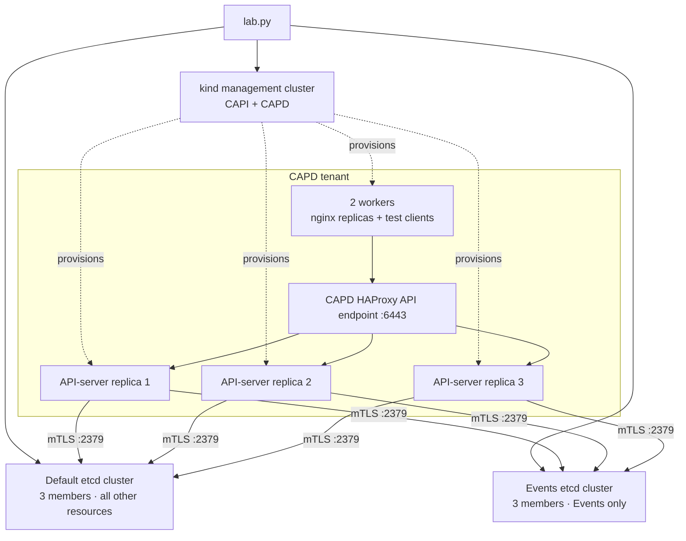

# Two-store external etcd POC

A standalone CAPD tenant with **three API-server replicas, two workers, and two
external three-member etcd clusters**. Events go to the `events` store; all other
resources go to `default`. Both stores use mTLS and separate persistent volumes.



The stores are Docker containers outside the Kubernetes nodes. Each has its own
quorum and peer traffic on port 2380. The resource split is a demonstration
fixture, not a fixed layout proposed for NVKE.

## Run

Requires Docker with Linux containers, `kind`, `kubectl`, Python 3.9+ and OpenSSL.
Select your Docker context first. From the repository root:

```bash
make -C controller clusterctl-install  # use gmake on macOS
python3 controller/hack/external-etcd/lab.py up
kubectl --kubeconfig controller/.local/external-etcd/tenant.kubeconfig get nodes
```

`up` provisions the environment and runs verification. Repeat checks or inspect:

```bash
python3 controller/hack/external-etcd/lab.py verify
python3 controller/hack/external-etcd/lab.py status
```

Credentials and generated manifests stay in the gitignored
`controller/.local/external-etcd/` directory. Certificates expire after 30 days;
recreate the lab rather than replacing keys under running members.

## What it validates

- Five Ready nodes; each API replica is ready, has both endpoint lists, and has
  no local etcd static Pod.
- Six healthy mTLS endpoints forming two distinct clusters with three voters each.
- Direct etcd reads prove a ConfigMap exists only in `default` and an Event only
  in `events`. Both Kubernetes Event APIs return the same Event identity.
- Two nginx replicas run on different workers; Pod-to-Pod HTTP, Service routing
  and cluster DNS work.

This proves normal operation on one Docker host. It does not integrate with the
NVKE create-cluster API or test kube-vip/BGP, failures, recovery or scale.

## Remove

```bash
python3 controller/hack/external-etcd/lab.py down
```

Deletes the tenant, dedicated management cluster, labelled etcd containers/data
volumes and generated credentials. Other clusters and Docker resources remain.
